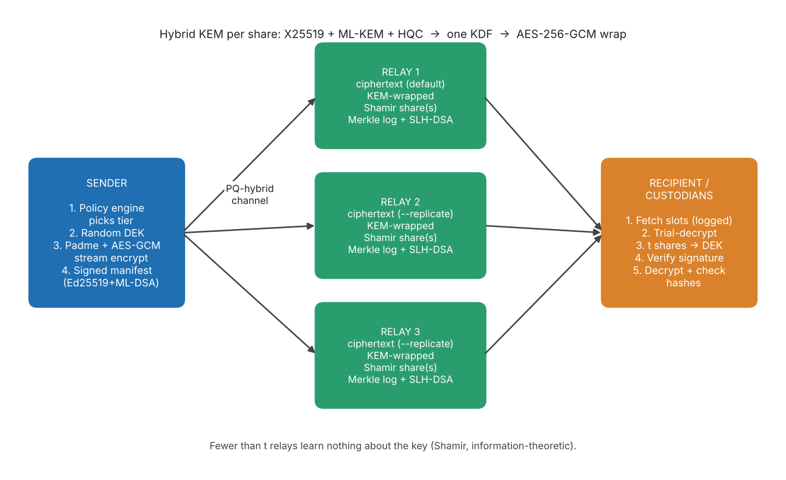

# PQFS 2.0 - Post-Quantum File Sharing System

> Files that stay secret even if a whole family of cryptography breaks, and even if some servers are hostile.

**Authors:** Pushkar Wagh (PRN 25030421030) and Vivaan Kriplani (PRN 25030421049)  |  Mini Project, End-Semester Examination, October 2026



## Why this exists

Encrypted data stolen today can be stored and decrypted later by a quantum computer ("harvest now, decrypt later"). Elliptic-curve and RSA key exchange would fall to Shor's algorithm. PQFS 2.0 is a command-line file-sharing tool built so that no single algorithm and no single server is a single point of failure.

## The six upgrades (v1 was AES-256-GCM + passphrase over raw TCP)

| # | Feature | What it does |
|---|---------|--------------|
| 1 | **Multi-family hybrid KEM** | X25519 (elliptic curve) + ML-KEM (lattice, FIPS 203) + HQC (code-based) secrets go into one HKDF. An attacker must break every family. |
| 2 | **Multipath secret sharing** | The file key is Shamir-split (t-of-n over GF(256)). Each share goes to a different relay. Fewer than t relays learn nothing about the key (information-theoretic). |
| 3 | **Crypto-agility** | File encrypted once with a random data key. `rewrap` re-issues only the small key-wrap layer when an algorithm is deprecated. Epochs, signed minimum-suite floor and a MAC defeat downgrade/rollback. |
| 4 | **Shelf-life policy engine** | Say how many years the secret must live; a transparent rule-based scorer (lifetime + sensitivity of file name/content) picks tier T1/T2/T3. `audit --fix` upgrades outdated wraps. |
| 5 | **Threshold custody + transparency** | t-of-n custodians must `approve` to open a file. Each relay keeps an RFC 6962-style Merkle log with SLH-DSA-signed tree heads; receipts carry inclusion proofs; `monitor` checks consistency. |
| 6 | **Metadata privacy** | File name, size, hashes and sender identity sit in an encrypted trailer. Padme padding hides size, all chunks are equal size, clients are anonymous, recipients are never named. |

### Security tiers

| Tier | KEM suite | Shares n / threshold t |
|------|-----------|------------------------|
| T1 ephemeral | X25519 + ML-KEM-768 | 1 / 1 |
| T2 standard | X25519 + ML-KEM-768 + HQC-192 | 3 / 2 |
| T3 long-term | X25519 + ML-KEM-1024 + HQC-256 | 5 / 3 |

## Install

Python 3.9+.

```bash
pip install -r requirements.txt
python main.py info
```

`liboqs-python` builds the native `liboqs` library on first import if it is not found. This needs `git`, `cmake` and a C compiler (on Ubuntu: `sudo apt install git cmake build-essential libssl-dev`). HQC needs a recent liboqs; `python main.py info` shows what your build supports.

## Quick start

```bash
python main.py selftest        # 24 unit checks
python main.py demo            # full end-to-end demo on localhost (about 10 s)
python bench.py                # benchmarks -> results/bench.json
```

Manual use (three relays in three terminals):

```bash
python main.py keygen alice ; python main.py keygen bob

python main.py relay --port 5001 --store ./r1
python main.py relay --port 5002 --store ./r2
python main.py relay --port 5003 --store ./r3

python main.py send report.pdf --id alice.id --to bob.pub \
    --relay 127.0.0.1:5001 --relay 127.0.0.1:5002 --relay 127.0.0.1:5003 --years 30

python main.py trust alice.pub                       # Bob trusts Alice's fingerprint
python main.py receive <pkg>.ticket.json --id bob.id --outdir ./inbox
```

Other commands: `assess` (policy dry run), `approve` (custodian releases a share), `deprecate`, `audit [--fix]`, `rewrap`, `verify-receipt`, `monitor`. Run `python main.py <command> -h`.

## Results (measured, single cloud CPU core, localhost)

| Check | Result |
|-------|--------|
| Unit self-tests | 24 / 24 pass |
| End-to-end demo scenarios (tamper, rollback, weak topology, 2-of-3 custody, rewrap, log monitor) | all behave as designed |
| AES-256-GCM streaming, 50 MiB file | ~186 MiB/s encrypt, ~150 MiB/s decrypt + full verification |
| Key wrap, tier T1 / T2 / T3 (encapsulate) | 0.10 / 9.6 / 23.1 ms |
| Package overhead | 0.08 % at 50 MiB, 2.6 % at 1 MiB |
| Merkle inclusion proof, 4,096 entries | 12 hashes (384 bytes) |

Raw outputs: [`results/`](results/). Full analysis: [`docs/PQFS2_Project_Report.pdf`](docs/PQFS2_Project_Report.pdf).

## Honest limits

- "Quantum-proof" means no known quantum attack. Nothing is proven, which is why everything is hybrid.
- liboqs is research-grade, HQC's final standard may be pending, and this project has **not been audited**. Educational use only.
- `rewrap` protects future recordings; it cannot un-leak ciphertext harvested under an old suite.
- Relays see IP addresses and timing. t colluding relays plus a break of all KEMs would recover the key.
- The policy engine is a deterministic heuristic, not a trained ML model.

## Repository layout

```
main.py            the whole system (keys, relay, client, policy engine, tests, demo)
bench.py           benchmark script
requirements.txt   Python dependencies
results/           selftest, demo output and benchmark JSON
docs/              report (PDF), architecture figure, poster
```

## License

MIT - see [LICENSE](LICENSE).
